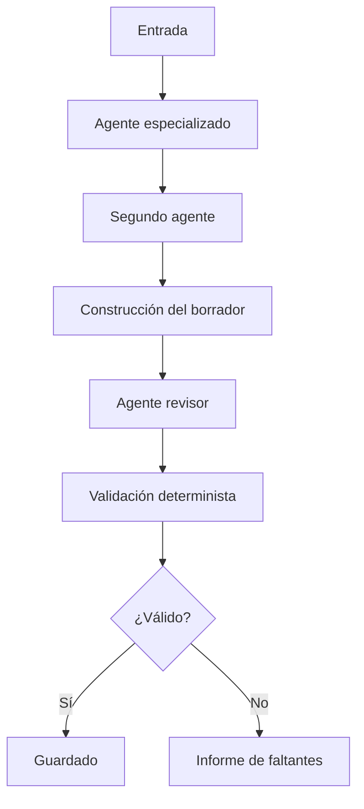
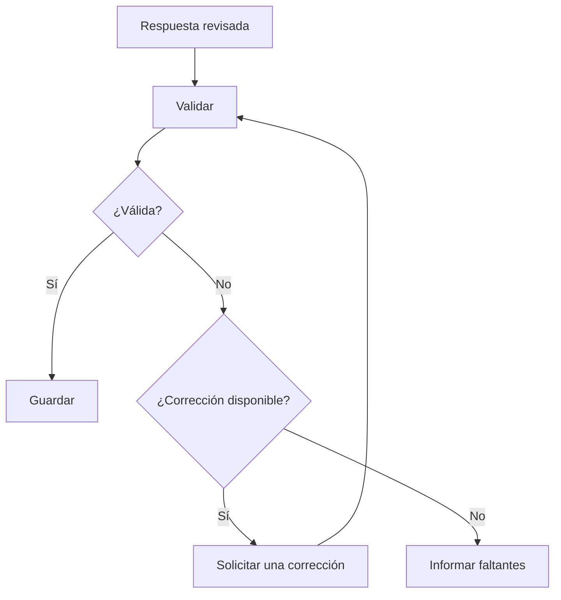

# Agentes de IA con Python: herramientas y orquestación básica

## Introducción

Una aplicación con agentes combina componentes generativos y deterministas. El modelo interpreta instrucciones y produce contenido variable; el código de Python controla el orden, valida condiciones, utiliza herramientas y decide si un resultado puede aceptarse.

Separar estas responsabilidades permite construir sistemas más fáciles de comprender, probar y mantener.

## Modelo, agente, herramienta y aplicación

| Componente | Responsabilidad |
| --- | --- |
| Modelo | Procesar una entrada y generar una respuesta |
| Agente | Utilizar un modelo con identidad, instrucciones, contexto y capacidades definidas |
| Herramienta | Ejecutar una operación concreta, normalmente mediante código o una API |
| Orquestador | Coordinar el orden, los datos y las decisiones del flujo |
| Aplicación | Integrar agentes, herramientas, validaciones, interfaz y almacenamiento |

Un modelo no se convierte automáticamente en agente. Un agente agrega un propósito y reglas de comportamiento, mientras que una aplicación controla cómo se utiliza su respuesta.

## Comportamiento generativo y determinista

Una distinción central es reconocer qué partes pueden variar y cuáles deben producir siempre un resultado predecible.

### Comportamiento generativo

Un modelo puede:

- explicar un concepto;
- redactar un ejemplo;
- resumir información;
- proponer una práctica;
- revisar un borrador.

La misma entrada puede producir respuestas diferentes. Una redacción convincente tampoco garantiza exactitud.

### Comportamiento determinista

El código convencional debe utilizarse para:

- comprobar que un valor no esté vacío;
- validar nombres y extensiones;
- verificar una estructura obligatoria;
- limitar la cantidad de reintentos;
- decidir si se guarda un archivo;
- controlar la ubicación de escritura;
- devolver estados y errores claros.

Las reglas que deben cumplirse exactamente no deberían depender únicamente de una respuesta del modelo.

## Agentes basados en modelos con ADK

El Agent Development Kit de Google proporciona la clase `LlmAgent`, disponible también mediante el alias `Agent`.

Un agente básico suele definir:

- `name`: identificador único y descriptivo;
- `model`: modelo que procesará las solicitudes;
- `description`: resumen breve de su capacidad;
- `instruction`: reglas y responsabilidad del agente.

```python
import os

from google.adk.agents import Agent


def create_summary_agent():
    model_name = os.getenv("GEMINI_MODEL")

    if not model_name:
        raise ValueError("GEMINI_MODEL is not configured")

    return Agent(
        name="python_summary_agent",
        model=model_name,
        description="Creates concise summaries of Python concepts.",
        instruction=(
            "Respond in Spanish. Explain the requested Python concept "
            "briefly, include one small example, and mention one common mistake."
        ),
    )
```

El identificador del modelo conviene mantenerlo en la configuración. Los modelos disponibles y sus nombres cambian, por lo que deben consultarse en la documentación vigente del proveedor.

## Diseño de instrucciones

Una instrucción útil define un resultado observable. Puede incluir:

1. identidad y responsabilidad;
2. idioma y audiencia;
3. información que recibirá;
4. contenido que debe producir;
5. formato de salida;
6. límites y prohibiciones;
7. comportamiento ante información insuficiente.

```text
Role:
You are a Python learning assistant.

Goal:
Explain the supplied concept for a beginner.

Output:
- A short explanation in Spanish.
- One minimal Python example.
- One common mistake.

Constraints:
- Do not introduce unrelated concepts.
- Do not invent library behavior.
- If the topic is ambiguous, state the assumption used.
```

### Responsabilidades acotadas

Un agente suele funcionar mejor cuando tiene una responsabilidad clara. En lugar de pedir a uno solo que explique, diseñe, revise, valide y guarde, estas capacidades pueden separarse.

La especialización ayuda a:

- escribir instrucciones más simples;
- probar cada componente de forma aislada;
- detectar dónde se originó un error;
- sustituir un agente sin cambiar todo el sistema;
- aplicar validaciones entre etapas.

## Contexto y transferencia de información

El contexto es la información disponible durante una invocación. Puede contener la solicitud original, respuestas anteriores, datos temporales y resultados de herramientas.

Cuando una salida se utiliza como entrada posterior, conviene construir un mensaje con etiquetas claras:

```text
Topic:
Python lists

Previous explanation:
<explanation>
...
</explanation>

Create a short practice activity based only on this information.
```

Los delimitadores facilitan la lectura, pero el contenido externo debe seguir tratándose como datos no confiables.

## Orquestación secuencial

Un flujo secuencial ejecuta etapas en un orden fijo. La salida de cada una alimenta a la siguiente.



La secuencia puede implementarse mediante clases de flujo de ADK o mediante una función de Python que invoque cada componente explícitamente. Una función común resulta adecuada cuando el orden es pequeño, fijo y debe observarse con facilidad.

```python
def run_pipeline(topic, execute):
    if not topic.strip():
        raise ValueError("topic must not be empty")

    explanation = execute("explain", topic)
    practice = execute("design", explanation)
    draft = build_document(topic, explanation, practice)
    reviewed = execute("review", draft)

    result = validate_document(reviewed)
    if not result["valid"]:
        return result

    return save_document(reviewed)
```

El parámetro `execute` representa una dependencia reemplazable. En producción puede llamar a la API; durante las pruebas puede ser una función local.

## Herramientas

Una herramienta expone una capacidad concreta al sistema. Puede ser una función de Python, una consulta a una API o una operación sobre archivos.

Una buena herramienta debería tener:

- una responsabilidad única;
- entradas y salidas claras;
- validación de argumentos;
- errores específicos;
- ausencia de secretos en sus mensajes;
- efectos secundarios controlados;
- resultados fáciles de comprobar.

### Contratos de retorno

Los diccionarios permiten representar éxito o fallo sin depender del texto impreso:

```python
{"ok": True, "path": "output/guide.md"}
```

```python
{"ok": False, "error": "invalid file name"}
```

El programa que llama a la herramienta debe revisar el estado antes de continuar.

### Herramientas y agentes no son equivalentes

Un revisor generativo puede señalar problemas de claridad. Una función de validación puede comprobar exactamente si existe un encabezado. Ambos componentes se complementan, pero no se sustituyen.

## Validación de contenido Markdown

Markdown utiliza texto plano y marcas sencillas. Una estructura puede comprobarse mediante reglas explícitas:

- título requerido;
- encabezados obligatorios;
- bloques de código con lenguaje declarado;
- contenido no vacío;
- ausencia de secretos o marcadores prohibidos.

Ejemplo de estructura:

````markdown
# Guide title

## Explanation

Text.

```python
print("example")
```

## Practice

Text.

## Review

Text.
````

La validación estructural no determina si una explicación es correcta. Solo confirma propiedades observables del documento.

### Validación de bloques de código

Una comprobación básica puede buscar una apertura ` ```python ` y su cierre. Si el formato admite variaciones complejas, es preferible utilizar un parser de Markdown en lugar de expresiones frágiles.

## Manejo seguro de rutas

Un nombre proporcionado externamente no debe concatenarse directamente con una carpeta de destino. Debe comprobarse antes de escribir.

Con `pathlib.Path` pueden revisarse propiedades importantes:

```python
from pathlib import Path


def is_safe_markdown_name(value):
    path = Path(value)

    return (
        value != ""
        and not path.is_absolute()
        and path.name == value
        and path.suffix == ".md"
        and ".." not in path.parts
    )
```

`path.name == value` rechaza rutas que incluyen subcarpetas. También conviene considerar separadores de Windows cuando el código se ejecuta en Linux y la entrada puede provenir de diferentes sistemas.

### Path traversal

Entradas como estas no deberían aceptarse cuando solo se espera un nombre:

```text
../secret.md
/tmp/output.md
folder/guide.md
C:\temp\guide.md
```

Una ruta aparentemente normal puede cambiar de significado debido a enlaces simbólicos. Para operaciones sensibles, debe comprobarse que la ruta resuelta permanezca dentro del directorio permitido.

## Escritura de archivos

Los archivos de texto deben abrirse con una codificación explícita:

```python
target.write_text(content, encoding="utf-8")
```

También puede utilizarse:

```python
with target.open("w", encoding="utf-8") as file:
    file.write(content)
```

### Evitar archivos parciales

Una escritura puede interrumpirse. Para reducir el riesgo:

1. escribir primero en un archivo temporal ubicado en la misma carpeta;
2. vaciar y cerrar correctamente el archivo;
3. reemplazar el destino únicamente cuando la escritura termina;
4. eliminar el temporal si ocurre un error.

El reemplazo dentro del mismo sistema de archivos suele ser atómico. De esta manera, el destino conserva la versión anterior o recibe la nueva completa.

## Configuración mediante variables de entorno

Los secretos y valores que cambian entre entornos no deben escribirse directamente en el código.

```dotenv
GOOGLE_API_KEY=replace_with_your_key
GEMINI_MODEL=replace_with_supported_model
```

En Python:

```python
import os

api_key = os.getenv("GOOGLE_API_KEY")
model_name = os.getenv("GEMINI_MODEL")
```

La aplicación debe comprobar que los valores necesarios existan sin imprimirlos.

### Archivos `.env`

Un archivo `.env` puede facilitar la configuración local, pero no cifra sus valores. Debe protegerse como un archivo sensible.

```gitignore
.env
```

Para verificar que Git lo ignora:

```bash
git check-ignore .env
```

Si el archivo ya fue incorporado al historial, añadirlo a `.gitignore` no elimina el secreto de confirmaciones anteriores. La clave debe revocarse y sustituirse.

Un `.env.example` puede documentar los nombres esperados con valores ficticios:

```dotenv
GOOGLE_API_KEY=
GEMINI_MODEL=
```

## Claves de Gemini

Las claves permiten autenticar solicitudes y asociarlas con un espacio de Google Cloud para cuotas y facturación.

Buenas prácticas:

- crear una clave para cada entorno;
- limitar su alcance cuando el proveedor lo permita;
- no incluirla en código, Git, documentación o capturas;
- rotarla si pudo quedar expuesta;
- evitar enviarla al modelo como parte de un prompt;
- revisar periódicamente el uso y las cuotas.

Google AI Studio crea actualmente claves de autorización de forma predeterminada. Las claves estándar antiguas o sin restricciones pueden ser rechazadas, por lo que conviene seguir siempre la guía actual de autenticación.

## Ejecución con Docker

Un contenedor proporciona un entorno reproducible con Python y las dependencias instaladas.

```bash
docker run --rm -it \
  --env-file .env \
  --user "$(id -u):$(id -g)" \
  -v "$PWD:/workspace" \
  -w /workspace \
  IMAGE_NAME python main.py
```

| Opción | Función |
| --- | --- |
| `--rm` | Elimina el contenedor cuando finaliza |
| `-it` | Habilita una sesión interactiva |
| `--env-file .env` | Carga variables dentro del contenedor |
| `--user "$(id -u):$(id -g)"` | Ejecuta con el usuario y grupo del host |
| `-v "$PWD:/workspace"` | Comparte la carpeta local con el contenedor |
| `-w /workspace` | Establece el directorio de trabajo |

Los archivos creados dentro del bind mount permanecen en el equipo anfitrión. Los cambios realizados fuera de ese montaje desaparecen al eliminar el contenedor.

`--user` ayuda a evitar archivos pertenecientes a `root` en Linux y WSL. Su sintaxis puede requerir adaptación en otros entornos.

## Pruebas sin consumir API

Las pruebas no deberían depender siempre de la red, la cuota o la disponibilidad de un modelo.

### Inyección de dependencias

Una función puede aceptar el ejecutor como argumento:

```python
def run(value, execute=real_executor):
    return execute(value)
```

En una prueba:

```python
def fake_executor(value):
    return f"simulated response for {value}"


def test_run_without_network():
    result = run("lists", execute=fake_executor)
    assert "simulated" in result
```

Esto permite controlar respuestas, contar invocaciones y simular fallos.

### `monkeypatch`

La fixture `monkeypatch` de pytest puede sustituir temporalmente atributos, funciones, diccionarios y variables de entorno. Los cambios se revierten al finalizar la prueba.

```python
def test_missing_key(monkeypatch):
    monkeypatch.delenv("GOOGLE_API_KEY", raising=False)
    # Verify the expected configuration error.
```

Para código propio suele ser preferible hacer explícitas las dependencias. `monkeypatch` resulta útil cuando no es práctico cambiar la firma o cuando se necesita controlar el entorno.

## Pruebas de herramientas y flujos

### Herramientas de archivos

Se deberían comprobar al menos:

- nombre válido;
- extensión incorrecta;
- ruta absoluta;
- subcarpeta;
- `..`;
- caracteres Unicode;
- carpeta inexistente;
- fallo de escritura;
- ausencia de archivos parciales.

### Validación de contenido

Conviene probar:

- documento completo;
- entrada vacía;
- cada sección ausente por separado;
- bloque de código sin lenguaje;
- contenido sensible;
- varias secciones similares;
- espacios y saltos de línea inesperados.

### Flujo secuencial

Un ejecutor falso puede registrar sus llamadas:

```python
calls = []


def fake_execute(role, content):
    calls.append((role, content))
    return RESPONSES[role]
```

Después se puede comprobar:

- orden de las llamadas;
- cantidad máxima de invocaciones;
- información recibida en cada etapa;
- validación anterior al guardado;
- interrupción del flujo ante un error.

## Errores esperados

Una aplicación con modelos puede fallar en varias capas.

| Categoría | Ejemplo | Respuesta apropiada |
| --- | --- | --- |
| Configuración | Falta una clave o modelo | Detener e indicar qué configuración falta |
| Autenticación | Clave inválida o revocada | Revisar o rotar la credencial |
| Modelo | Identificador inexistente o no disponible | Consultar modelos compatibles |
| Cuota | `429 RESOURCE_EXHAUSTED` | Esperar hasta recuperar cuota o reducir solicitudes |
| Servicio | `503 Service Unavailable` | Esperar y realizar un reintento limitado |
| Red | Timeout o fallo de conexión | Informar y aplicar una política acotada |
| Respuesta | Contenido vacío | Rechazar antes de continuar |
| Validación | Estructura incompleta | Informar los requisitos faltantes |
| Escritura | Permisos o disco | No dejar contenido parcial |

### Excepciones específicas

No conviene envolver toda la aplicación en un único `except Exception`. Las excepciones conocidas deberían manejarse cerca de la operación que puede producirlas.

```python
try:
    response = execute_agent(agent, message)
except RateLimitError as error:
    return {"ok": False, "error": "rate limit reached"}
except ServiceUnavailableError as error:
    return {"ok": False, "error": "service temporarily unavailable"}
```

Un manejador genérico en el nivel superior puede registrar fallos inesperados, pero no debería ocultar su causa durante el desarrollo.

## Límites de la API

Los límites de Gemini pueden medirse mediante:

- RPM: solicitudes por minuto;
- TPM: tokens de entrada por minuto;
- RPD: solicitudes por día.

Los límites se aplican normalmente por espacio de Google Cloud, no por cada clave individual, y dependen del modelo y del nivel de uso.

Una aplicación debe evitar reintentos inmediatos e ilimitados. Para fallos transitorios puede utilizarse espera progresiva, variación aleatoria y un máximo pequeño de intentos.

No todos los `429` son iguales: un límite temporal puede recuperarse después de esperar, mientras que una cuota diaria requiere aguardar su restablecimiento o cambiar el nivel autorizado.

## Reintentos controlados

Un reintento resulta apropiado cuando el error es temporal y repetir la operación es seguro.

```text
attempt → temporary error → wait → one retry → finish
```

Se debe evitar:

- reintentar una entrada inválida;
- cambiar de proveedor silenciosamente;
- repetir sin límite;
- duplicar escrituras o acciones externas;
- ocultar que la segunda llamada también falló.

El SDK puede aplicar sus propios reintentos HTTP. Una invocación del ejecutor no implica necesariamente una única solicitud de red.

## Corrección limitada

Una respuesta incompleta puede enviarse nuevamente a un agente junto con los requisitos faltantes. Este mecanismo debe tener un límite explícito.



Un ciclo abierto vuelve impredecibles el costo, el tiempo y la cantidad de llamadas. La validación determinista debe repetirse después de la corrección.

## Privacidad y seguridad

- No enviar datos personales si no son necesarios.
- No registrar claves ni fragmentos de claves.
- Evitar incluir secretos dentro de excepciones.
- Revisar las políticas de retención del proveedor.
- Utilizar datos simulados durante el desarrollo.
- Validar el contenido generado antes de guardarlo o ejecutarlo.
- No ejecutar automáticamente código producido por un modelo.
- Aplicar mínimo privilegio a archivos, herramientas y credenciales.

### Contenido sensible en salidas

Una validación puede comprobar que el resultado no contenga secretos conocidos o marcadores de prueba. Esta medida es complementaria: no reemplaza la protección adecuada de credenciales.

## Portabilidad entre proveedores

Separar el ejecutor de la lógica permite cambiar de modelo o proveedor sin reescribir la orquestación.

Una interfaz mínima puede recibir:

- agente o configuración;
- mensaje;
- contexto opcional.

Y devolver:

- texto generado;
- error específico;
- metadatos opcionales de uso.

Al cambiar de proveedor pueden variar:

- autenticación;
- identificadores de modelos;
- límites y precios;
- parámetros de generación;
- formato de errores;
- soporte de herramientas;
- tratamiento de datos.

## Documentación de la aplicación

Un README útil debería explicar:

- propósito y limitaciones;
- estructura de carpetas;
- responsabilidades de agentes y herramientas;
- configuración mediante variables de entorno;
- comandos reproducibles;
- ejecución normal y simulada;
- pruebas;
- errores frecuentes;
- privacidad y seguridad;
- ejemplos sin información personal.

Los comandos documentados deben probarse. Los ejemplos deben utilizar valores ficticios y nunca claves reales.

## Recursos recomendados

### Conceptos y ADK

- [Conceptos centrales de los agentes de IA](https://cloud.google.com/resources/core-concepts-ai-agents)
- [Qué son los agentes de IA](https://cloud.google.com/discover/what-are-ai-agents)
- [Agentes basados en modelos con ADK](https://adk.dev/agents/llm-agents/)
- [Flujos secuenciales en ADK](https://adk.dev/agents/workflow-agents/sequential-agents/)
- [Contexto de los agentes en ADK](https://adk.dev/context/)

### Gemini

- [Estrategias para diseñar prompts](https://ai.google.dev/gemini-api/docs/prompting-strategies)
- [Uso seguro de claves de Gemini](https://ai.google.dev/gemini-api/docs/api-key?hl=es-419)
- [Límites de frecuencia](https://ai.google.dev/gemini-api/docs/rate-limits?hl=es-419)
- [Errores de la API](https://ai.google.dev/gemini-api/docs/api-errors?hl=es-419)
- [Solución de problemas](https://ai.google.dev/gemini-api/docs/troubleshooting?hl=es-419)

### Python y pruebas

- [Lectura y escritura de archivos en Python 3.12](https://docs.python.org/3.12/tutorial/inputoutput.html#reading-and-writing-files)
- [Errores y excepciones en Python 3.12](https://docs.python.org/3.12/tutorial/errors.html)
- [`pathlib` en Python 3.12](https://docs.python.org/3.12/library/pathlib.html)
- [Sustituir dependencias con `monkeypatch`](https://docs.pytest.org/en/stable/how-to/monkeypatch.html)

### Docker y Git

- [Bind mounts en Docker](https://docs.docker.com/engine/storage/bind-mounts/)
- [`docker container run`](https://docs.docker.com/reference/cli/docker/container/run/)
- [Ignorar archivos con Git](https://docs.github.com/es/get-started/git-basics/ignoring-files)
