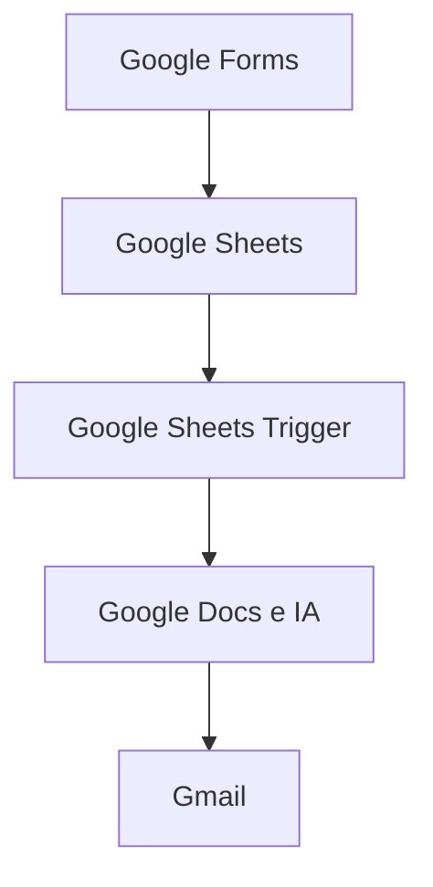

# Automatización con n8n y Google Workspace

## Introducción

n8n es una plataforma de automatización que permite conectar aplicaciones, transformar datos y ejecutar acciones mediante flujos visuales. Cada flujo se construye con nodos enlazados entre sí: un nodo recibe información, realiza una operación y produce un resultado para el siguiente.

Una automatización puede recibir datos desde un formulario, almacenarlos en Google Sheets, consultar información en Google Docs, procesarla con un modelo de inteligencia artificial y enviar el resultado por correo electrónico. Aunque el editor reduce la necesidad de programar, sigue siendo importante comprender cómo circulan los datos, cómo se autentican los servicios y cómo se verifican los resultados.

Esta guía utiliza como ejemplo un proceso para adaptar documentos de postulación laboral:



## Conceptos fundamentales de n8n

### Workflow

Un **workflow** es un conjunto de nodos conectados que representa un proceso automatizado. El orden de las conexiones determina cómo circula la información.

Un flujo normalmente contiene:

- un punto de inicio;
- nodos que consultan o transforman datos;
- condiciones o decisiones, cuando son necesarias;
- una acción final;
- manejo de errores y registros de ejecución.

### Nodos

Un **nodo** representa una operación concreta. Por ejemplo:

- detectar una fila nueva;
- obtener un documento;
- generar texto con un modelo;
- enviar un correo;
- modificar datos;
- consultar una API.

Los nodos principales procesan elementos de entrada y producen elementos de salida. Algunos nodos de IA también utilizan **subnodos** para conectar modelos, herramientas, memoria o analizadores de salida.

### Disparadores y acciones

Un **trigger** (en español, **disparador**) inicia el flujo cuando ocurre un evento. La interfaz de n8n está en inglés, por lo que el nombre de estos nodos siempre aparece como "Trigger" (por ejemplo, "Google Sheets Trigger"); "disparador" es la forma en la que se los nombra en español. Un nodo de acción, en cambio, solo se ejecuta cuando recibe datos desde un nodo anterior.

Ejemplos de disparadores:

- una fila añadida a Google Sheets;
- un formulario enviado;
- una hora programada;
- una solicitud recibida mediante webhook.

Ejemplos de acciones:

- leer un documento;
- generar contenido;
- enviar un correo;
- actualizar una hoja de cálculo.

### Ejecuciones

Cada vez que un flujo se pone en marcha se crea una **ejecución**. El historial de ejecuciones permite revisar:

- qué datos recibió cada nodo;
- qué resultado produjo;
- cuánto demoró;
- dónde se produjo un error;
- si la ejecución terminó correctamente.

Durante el desarrollo conviene probar los nodos individualmente. El flujo debería activarse para uso automático únicamente después de verificar el recorrido completo.

## Cómo circulan los datos

n8n representa los datos principalmente como objetos JSON. Cada elemento puede contener varios campos:

```json
{
  "Company Name": "Acme Corp",
  "Position Title": "Software Engineer",
  "Job Description": "Desarrollar y mantener aplicaciones internas.",
  "Job Requirements": "Python, Git y habilidades de comunicación."
}
```

Los nombres de los campos dependen de la fuente. No se debe asumir que n8n reemplazará automáticamente los espacios por guiones bajos.

### Expresiones

Las expresiones insertan valores dinámicos dentro de los parámetros de un nodo.

Para obtener un campo del elemento actual:

```text
{{ $json["Company Name"] }}
```

Para obtener un campo producido por otro nodo:

```text
{{ $('Google Sheets Trigger').item.json["Position Title"] }}
```

El nombre del nodo y el nombre del campo deben coincidir exactamente con los que aparecen en la ejecución.

La interfaz también permite arrastrar datos desde el panel de entrada hasta un parámetro. Esta acción genera la expresión correspondiente y reduce errores de escritura.

### Datos estáticos y dinámicos

Un valor **estático** permanece igual en todas las ejecuciones:

```text
Tus documentos están listos.
```

Un valor **dinámico** cambia según los datos recibidos:

```text
Application Ready: {{ $json["Position Title"] }}
```

Combinar ambos tipos permite crear mensajes y prompts reutilizables.

## Google Forms y Google Sheets

Google Forms puede utilizarse como interfaz de entrada. Al vincular un formulario con Google Sheets, cada respuesta genera una nueva fila.

Para mantener un flujo predecible:

- utilizar nombres de campos claros y estables;
- marcar como obligatorios los datos esenciales;
- evitar cambiar encabezados después de configurar las expresiones;
- enviar datos ficticios durante las pruebas;
- comprobar que la hoja y la pestaña seleccionadas sean las correctas.

### Google Sheets Trigger

El nodo **Google Sheets Trigger** puede detectar:

- una fila añadida;
- una fila actualizada;
- una fila añadida o actualizada.

Para procesar nuevas respuestas suele utilizarse el evento **Row Added**.

El disparador de Google Sheets no es lo mismo que el nodo normal de Google Sheets. El disparador inicia el flujo; el nodo normal lee, crea, actualiza o elimina datos cuando otro nodo lo ejecuta.

## Google Docs como fuente de información

El nodo **Google Docs** admite operaciones para crear, obtener y actualizar documentos.

Cuando se utiliza un documento como fuente:

- mantener una estructura sencilla;
- utilizar títulos y texto legible;
- evitar diseños que dependan de tablas complejas o imágenes;
- revisar el contenido obtenido por el nodo antes de enviarlo a un modelo.

El identificador de un documento se encuentra normalmente entre `/d/` y `/edit` en su URL:

```text
https://docs.google.com/document/d/DOCUMENT_ID/edit
```

El documento no necesita hacerse público si n8n accede mediante una cuenta de Google autorizada. Es preferible conservarlo privado y conceder solamente los permisos necesarios mediante OAuth.

## Credenciales y OAuth

Las credenciales permiten que n8n se conecte con servicios externos sin incluir contraseñas o claves directamente en los nodos.

### n8n Cloud

Para determinados nodos de Google, n8n Cloud permite iniciar sesión mediante **Managed OAuth2**. La autenticación se realiza directamente con Google sin configurar previamente una aplicación en Google Cloud.

### Instalaciones autoalojadas

Una instalación propia normalmente requiere **Custom OAuth2**:

1. Crear un proyecto en Google Cloud.
2. Habilitar las API necesarias.
3. Configurar la pantalla de consentimiento.
4. Crear un cliente OAuth para una aplicación web.
5. Copiar desde n8n la URL de redirección autorizada.
6. Guardar el Client ID y el Client Secret como credencial.
7. Autorizar la cuenta y probar la conexión.

La URL de redirección depende de la instancia. Debe copiarse desde la configuración de la credencial en lugar de escribir una dirección fija tomada de otro entorno.

### Buenas prácticas

- No pegar claves de API dentro de prompts, expresiones o notas.
- No guardar secretos en capturas de pantalla.
- Solicitar únicamente los permisos necesarios.
- Separar credenciales personales, educativas y de producción.
- Revocar credenciales que ya no se utilicen.
- Evitar publicar documentos que contienen información personal.
- Probar inicialmente con la propia dirección de correo.

## Generación de contenido con IA

Un nodo de IA combina datos del flujo con instrucciones para un modelo. El proveedor, el nombre del nodo y los modelos disponibles pueden cambiar; la lógica general sigue siendo la misma.

Un prompt útil debería incluir:

- la función del modelo;
- los datos de entrada;
- el resultado esperado;
- el formato;
- las restricciones;
- el comportamiento ante información ausente.

### Carta de presentación

```text
Redacta una carta de presentación profesional para el puesto indicado.

Empresa: {{ $json["Company Name"] }}
Puesto: {{ $json["Position Title"] }}
Descripción: {{ $json["Job Description"] }}
Requisitos: {{ $json["Job Requirements"] }}

Utiliza tres párrafos:
1. Presentación e interés en el puesto.
2. Relación entre la experiencia disponible y los requisitos.
3. Cierre profesional.

No inventes experiencia, habilidades, estudios ni logros.
Si falta información, evita completarla mediante suposiciones.
```

### Adaptación de un CV

```text
Adapta el siguiente CV para destacar la información relevante para el puesto.

CV original:
{{ $('Google Docs').item.json.content }}

Puesto:
{{ $('Google Sheets Trigger').item.json["Position Title"] }}

Requisitos:
{{ $('Google Sheets Trigger').item.json["Job Requirements"] }}

Conserva únicamente información presente en el CV original.
No inventes experiencia, habilidades, fechas, certificaciones ni resultados.
Reorganiza y reformula el contenido sin alterar los hechos.
```

El nombre del campo que contiene el texto de Google Docs debe confirmarse en la salida real del nodo.

## Cadenas, agentes, herramientas y memoria

### Basic LLM Chain

**Basic LLM Chain** ejecuta un proceso predecible:

1. recibe una entrada;
2. construye un prompt;
3. consulta un modelo;
4. devuelve una salida.

Es apropiado cuando el paso está definido de antemano, como resumir, clasificar o reescribir un texto.

Puede utilizar mensajes de sistema, usuario y ejemplo, además de analizadores para exigir un formato específico.

### AI Agent

Un **AI Agent** conecta un modelo con una o más herramientas. El agente decide qué herramienta utilizar para alcanzar un objetivo.

Una herramienta puede:

- consultar un documento;
- realizar un cálculo;
- ejecutar otro workflow;
- llamar una API;
- utilizar código controlado.

Un agente debe tener al menos una herramienta conectada. Las descripciones de las herramientas deben ser claras para que el modelo pueda elegirlas correctamente.

No conviene utilizar un agente cuando una secuencia fija resuelve el problema. Un flujo determinista suele ser más sencillo de comprender, probar y mantener.

### Memoria

La memoria conserva información entre mensajes o interacciones. Resulta útil en conversaciones, pero no siempre es necesaria en automatizaciones independientes.

Si cada fila representa un proceso separado, compartir memoria entre ejecuciones podría mezclar datos de personas o solicitudes diferentes. La clave de sesión debe aislar correctamente cada conversación cuando la memoria sea realmente necesaria.

## Envío con Gmail

El nodo **Gmail** permite enviar mensajes configurando:

- destinatario;
- asunto;
- tipo de contenido, como texto o HTML;
- cuerpo del mensaje;
- archivos adjuntos opcionales;
- copias y otras opciones de envío.

Ejemplo de asunto dinámico:

```text
Application Ready: {{ $('Google Sheets Trigger').item.json["Position Title"] }} at {{ $('Google Sheets Trigger').item.json["Company Name"] }}
```

Antes de automatizar envíos externos:

- utilizar una dirección propia durante las pruebas;
- revisar el contenido generado;
- comprobar que los campos no estén vacíos;
- evitar duplicados;
- limitar la frecuencia de envío;
- incorporar aprobación humana cuando el mensaje tenga consecuencias reales.

## Verificación de extremo a extremo

Una prueba completa debería comprobar:

1. La entrada crea una fila con los campos esperados.
2. El disparador detecta el evento.
3. El documento se obtiene correctamente.
4. El modelo recibe todos los datos necesarios.
5. La salida respeta el formato y no inventa información.
6. El correo utiliza el destinatario y asunto correctos.
7. La ejecución queda registrada sin errores.

Conviene realizar al menos dos pruebas con entradas diferentes. Los resultados deberían cambiar según los datos, pero conservar la estructura definida.

### Diagnóstico de problemas frecuentes

| Problema | Qué revisar |
| --- | --- |
| El flujo no comienza | Estado del workflow, evento del disparador, archivo y pestaña seleccionados |
| Faltan campos | Encabezados de la hoja y salida JSON del disparador |
| Una expresión devuelve vacío | Nombre exacto del nodo, campo y elemento relacionado |
| Google rechaza la conexión | Cuenta autorizada, permisos, API habilitadas y URL de redirección |
| El modelo devuelve un error | Credencial, modelo disponible, cuota y tamaño de la entrada |
| El contenido resulta incorrecto | Datos de entrada, prompt, contexto y restricciones |
| El correo no llega | Destinatario, ejecución del nodo, spam y límites de Gmail |
| Se repiten correos | Configuración del disparador, reintentos e identificadores ya procesados |

## Seguridad, privacidad y uso responsable

Los CV, descripciones laborales y correos pueden contener datos personales. Se recomienda:

- minimizar los datos enviados al modelo;
- conocer las políticas del proveedor de IA;
- conservar los documentos privados;
- no registrar secretos;
- eliminar datos de prueba innecesarios;
- revisar manualmente todo documento antes de utilizarlo;
- impedir que el modelo invente antecedentes;
- no enviar postulaciones automáticamente sin aprobación humana.

La automatización puede preparar borradores, pero la persona sigue siendo responsable de verificar su exactitud y decidir su uso.

## Recomendaciones de uso cotidiano

- Asignar nombres descriptivos a los nodos.
- Mantener prompts y expresiones fáciles de localizar.
- Probar un nodo antes de conectar el siguiente.
- Revisar los datos de entrada y salida en cada paso.
- Utilizar datos ficticios durante el desarrollo.
- Guardar una copia antes de realizar cambios grandes.
- Documentar las credenciales requeridas sin copiar secretos.
- Separar la preparación del contenido y el envío definitivo.
- Consultar el historial de ejecuciones antes de repetir manualmente un proceso.
- Revisar la documentación cuando una opción de la interfaz haya cambiado.

## Recursos oficiales

### n8n

- [Sitio oficial de n8n](https://n8n.io/)
- [Documentación general](https://docs.n8n.io/)
- [Mapeo de datos en la interfaz](https://docs.n8n.io/data/data-mapping/data-mapping-ui/)
- [Google Sheets Trigger](https://docs.n8n.io/integrations/builtin/trigger-nodes/n8n-nodes-base.googlesheetstrigger/)
- [Nodo Google Docs](https://docs.n8n.io/integrations/builtin/app-nodes/n8n-nodes-base.googledocs/)
- [Credenciales de Google](https://docs.n8n.io/integrations/builtin/credentials/google/)
- [Operaciones de Gmail](https://docs.n8n.io/integrations/builtin/app-nodes/n8n-nodes-base.gmail/message-operations/)
- [Basic LLM Chain](https://docs.n8n.io/integrations/builtin/cluster-nodes/root-nodes/n8n-nodes-langchain.chainllm/)
- [AI Agent](https://docs.n8n.io/integrations/builtin/cluster-nodes/root-nodes/n8n-nodes-langchain.agent/)
- [Historial de ejecuciones](https://docs.n8n.io/workflows/executions/all-executions/)

### Google Workspace

- [Ayuda de Google Forms](https://support.google.com/docs/topic/6063584)
- [Ayuda de Google Sheets](https://support.google.com/docs/topic/9054603)
- [Ayuda de Google Docs](https://support.google.com/docs/topic/1382883)

